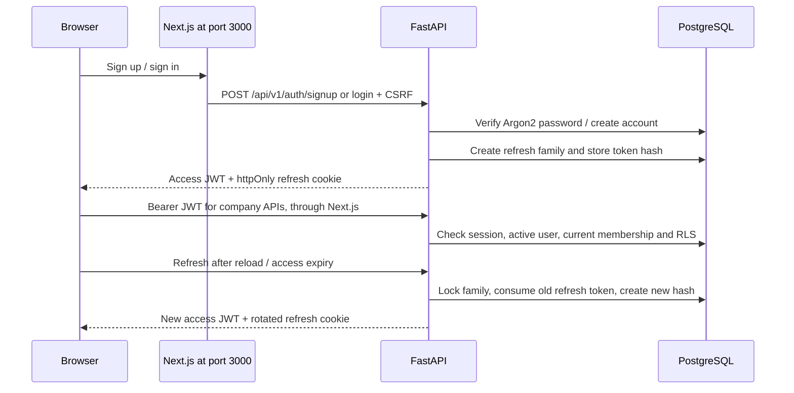

# ResolveAI authentication and multi-tenancy

This guide explains the authentication and tenant foundation in the supplied
system design. Everything runs in the existing ResolveAI application at
`http://localhost:3000`; there is no separate personal chatbot or frontend origin.

## 1. What changed

The earlier application put login/signup inside the home screen, used a
week-long cookie JWT, treated a workspace creator as an admin, and selected a
workspace from a route after checking membership. That was a partial implementation
of the supplied design. There were no dedicated `/login` and `/signup` pages,
refresh rotation, signed active workspace, owner permissions or invitation flow.

The application now has explicit account pages, onboarding, a workspace switch,
owner/admin/agent roles, invitations and member management. Authentication does
not need a Gemini key or model credits. Company chat remains in Knowledge base.

## 2. Upgrade and first use

Keep your private `backend/.env`. Set a random `JWT_SECRET_KEY` of at least 32
characters. A new value can be generated locally with:

```powershell
python -c "import secrets; print(secrets.token_urlsafe(48))"
```

Copy it into `.env`; keep it private. `COOKIE_SECURE=false` is appropriate for
local HTTP. Use `true` for an HTTPS deployment. Bootstrap checks the signing key
and prints an actionable error if it is missing, weakly sized or a placeholder.

With Docker Desktop running, from the repository root:

```powershell
git switch dev
git pull --ff-only origin dev
docker compose --env-file backend/.env up --build --force-recreate -d
docker compose --env-file backend/.env ps
```

Open `/signup`, enter your name/email/password, then create your first workspace
at `/onboarding`. Choose Local demo for a complete test without a provider key.
You become its **owner**. Upload a company document at `/knowledge`, wait for
Ready, and ask a question. `/login` signs an existing account back in.

Existing accounts, passwords, documents, tickets and workspaces are preserved.
Migrations promote each workspace's creator to owner and revoke the obsolete
cookie sessions. Everyone signs in again once after upgrading.

## 3. Session workflow



- **Access:** HS256 JWT, 15 minutes, `sub`, `sid`, `wid`, `role`, `iat`, `exp` and
  an access-token type. It stays in JavaScript memory. No access credential goes
  into localStorage/sessionStorage or a JWT cookie.
- **Refresh:** 30-day opaque random value in an httpOnly, SameSite=Lax cookie
  limited to `/api/v1/auth`. Only its SHA-256 hash is stored. The expiry is bounded
  by the session family's original lifetime.
- **Rotation:** every successful refresh consumes the previous value. Reusing it
  revokes the entire family, including access JWTs issued from that family.
- **Logout:** revokes the current family and clears cookies. It also works when
  the access JWT has expired. Other browser tabs are notified.
- **Current permissions:** each request looks up membership and role again.
  Demoting an admin takes effect even if their access JWT still says admin.
- **Concurrency:** the browser serializes cookie-changing auth operations across
  tabs and shares an in-flight refresh within a tab. Server family/token locks
  serialize rotation and logout; duplicate refresh reuse fails closed.

Cookie-changing authentication requests use a double-submit CSRF token. Bearer
business APIs do not rely on an automatically attached session cookie. Responses
are private/no-store. Passwords are Argon2 hashes, never plaintext.

## 4. A user can belong to several companies

Users are global accounts; memberships connect a user to a workspace and role.
The workspace selector calls a switch endpoint that verifies membership and
returns a new signed access token. An unknown/foreign workspace returns 404.

The active `wid` is taken from that verified token. A document/ticket ID, request
body, query string or compatibility URL cannot silently switch it. An optional
`X-Workspace-ID` header is an assertion, not authority: mismatches are rejected.
Canonical resource repositories add the active workspace predicate automatically.

Every business table is also covered by PostgreSQL RLS. Transactions set
`app.user_id` and `app.workspace_id` locally, including after commit/rollback.
The API connects as `resolveai_app`, not the owner or a role with RLS bypass.
The worker carries workspace IDs in jobs and uses `resolveai_worker` under the
same workspace boundary. Named migration credentials are removed before the API starts. Use distinct
runtime passwords for non-local deployments; local Compose offers an existing-
password fallback for convenience.

Tenant mutations serialize before child-row locks, including worker completion
and workspace deletion. Slow knowledge/drafting provider work does not hold that
mutation lock. The answer/draft is checked again before it is persisted.

Switching clears documents, questions, conversations and ticket state. Client
responses from the previous workspace are ignored. If refresh changes the
account/workspace, a mutation is not replayed against the new company. React's
preserved routes are gated by the live account/workspace; form IDs are unique.

## 5. Roles and invitations

| Role  | Permissions                                                                                                                    |
| ----- | ------------------------------------------------------------------------------------------------------------------------------ |
| Owner | All admin operations; permanently delete their workspace with exact-name confirmation                                          |
| Admin | Manage documents/settings, invite teammates, change roles/remove members, inspect orders/audit, approve sensitive mock actions |
| Agent | Read company knowledge, work tickets, prepare drafts, approve low-risk replies/escalations and leave feedback                  |

Owners cannot be removed or demoted. Agents cannot use member administration,
change workspace settings, inspect admin-only mock-order/audit lists, or approve
refund/replacement proposals. The combined dashboard endpoint respects those
same restrictions.

To add someone, open **Workspace team**, enter the target email and role, and
create an invitation. Copy and share the link yourself; no email is sent and no
email-service API key is required. The person may sign up first or afterward.
Only an account matching the invited email can accept it.

Links expire in seven days, can be revoked, and are replaced when reinvited.
They carry the invitation value in a URL fragment so it is not sent in HTTP
request URLs. Only its hash is stored. A pending invitation can briefly use
sessionStorage; that entry is an invitation, not an access/refresh credential.
Re-accepting an old link cannot restore a removed membership or elevated role.

Auth events are recorded in a private account-security log. Workspace role,
invitation, review and action events are workspace-scoped. A deletion record is
retained in the account-security log after the workspace and its private files
are removed. The runtime cannot update/delete audit events directly.

## 6. API endpoints and Swagger

Open **http://localhost:3000/docs** or `/api/v1/docs`. The schema is at
`/api/v1/openapi.json`. These use the same web origin as the application.

| Method and path                          | Purpose                                                         |
| ---------------------------------------- | --------------------------------------------------------------- |
| `GET /api/v1/auth/csrf`                  | Obtain the CSRF cookie and matching header value                |
| `POST /api/v1/auth/signup`               | `{full_name, email, password}`; password at least 12 characters |
| `POST /api/v1/auth/login`                | `{email, password}`; returns access token and user              |
| `POST /api/v1/auth/refresh`              | Rotate the opaque refresh cookie                                |
| `POST /api/v1/auth/logout`               | Revoke the current session family                               |
| `GET /api/v1/auth/me`                    | Read the current user and active workspace/role                 |
| `GET / POST /api/v1/workspaces`          | List joined workspaces / create a workspace                     |
| `POST /api/v1/workspaces/{id}/switch`    | Validate membership and issue workspace-bound access            |
| `GET / PATCH /api/v1/workspace/settings` | Read/update active-company settings                             |
| `GET /api/v1/members`                    | Owner/admin membership list                                     |
| `POST /api/v1/members/invite`            | Create a seven-day invitation                                   |
| `PATCH / DELETE /api/v1/members/{id}`    | Change role / remove a non-owner member                         |
| `GET / DELETE /api/v1/invitations[/id]`  | List / revoke invitations                                       |
| `POST /api/v1/invitations/accept`        | Accept `{token}` as the invited account                         |
| `DELETE /api/v1/workspaces/{id}`         | Owner confirmation and permanent removal                        |

Company APIs include `/documents`, `/knowledge/search`, `/knowledge/ask`,
`/conversations`, `/tickets`, `/tickets/{id}/regenerate-draft`, `/mock-orders`,
`/analytics/overview` and `/audit-logs`, all under `/api/v1`. Document, ticket,
conversation, order and audit lists support scoped cursors where exposed.
The older workspace-prefixed APIs remain compatible only for the signed active
workspace. Their direct-add-existing-member endpoint remains a compatibility API;
the current team UI uses recipient-accepted invitations.

For Swagger testing, first execute CSRF, copy its value into the auth request's
`x-csrf-token` header, then execute signup/login. Copy `access_token` into Swagger's
Bearer **Authorize** dialog. Create a workspace, execute its switch endpoint, and
replace Authorize with the new access token before testing company resources.
The login API uses POST; the `/login` webpage uses GET.

## 7. Files and regression checks

| Files                                                                    | Responsibility                                                         |
| ------------------------------------------------------------------------ | ---------------------------------------------------------------------- |
| `backend/auth/security.py`, `service.py`, `dependencies.py`, `router.py` | Hashes, cookies, session families, JWT validation and auth APIs        |
| `backend/workspaces/service.py`, `router.py`, `schemas.py`               | Onboarding, settings, roles, invitations and deletion                  |
| `backend/database/tenant.py`, `repository.py`, `security_v2.py`          | Transaction context, automatic query scoping and RLS                   |
| `backend/database/migrations/versions/0007_*`, `0008_*`                  | Additive auth/owner/invitation schema, backfill and expiry maintenance |
| `frontend/app/auth-form.tsx`, `/login`, `/signup`, `/invite`             | Visible authentication and invitation pages                            |
| `frontend/app/resolve/api.ts`                                            | In-memory access, serialized refresh, identity changes and logout      |
| `frontend/app/resolve/workspace-panels.tsx`                              | Team, roles, invitations and settings controls                         |
| `frontend/e2e/auth-tenancy.spec.ts`                                      | Browser auth, tenant RAG, roles and history regressions                |

Backend integration tests use disposable schemas in real PostgreSQL/pgvector.
They test expired/reused tokens, logout, duplicate requests, recipient matching,
role changes, foreign IDs/cursors and non-owner RLS. Browser tests use separate
accounts and the actual worker in Local mode, with no model calls.

See [the implementation map](architecture.md) for the complete design audit.
Public customer widget/SSE, the expanded ticket lifecycle, external-action outbox,
per-call pricing/hard daily model budgets, full generated client, cloud deployment
and measured evaluation targets are not claimed as complete in this dashboard pass.
