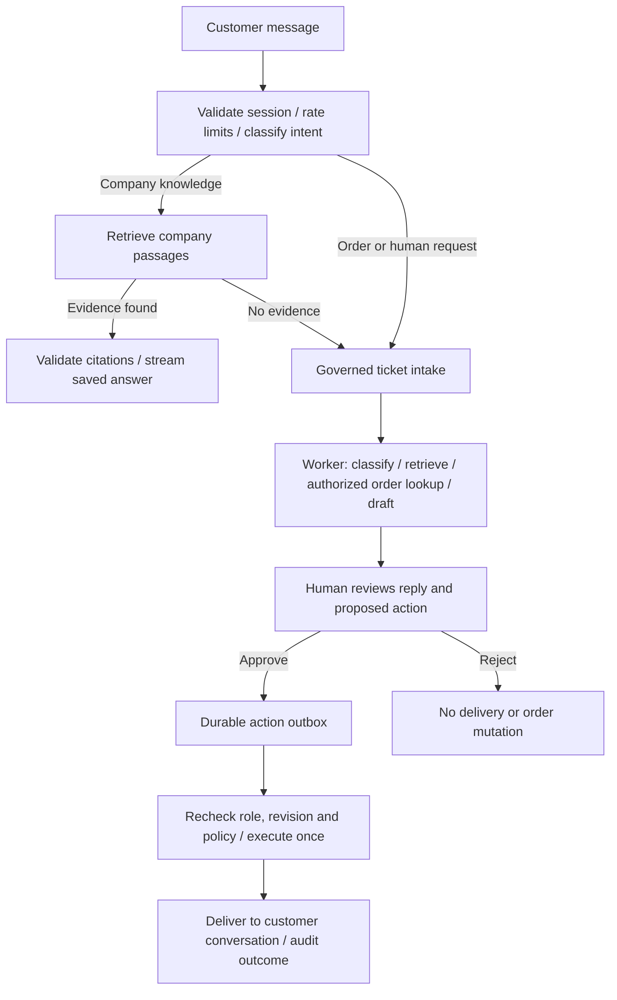

# Customer support, order tools and reviewed delivery

ResolveAI now serves staff and customers from the same Next.js application at
`http://localhost:3000`. Company-document testing remains in **Knowledge base**.
The customer portal and optional embedded widget are additional routes in that
application, not a second chatbot service.

## Try the complete workflow

1. Sign in at `/login`, or create a staff account at `/signup` and a workspace.
   Use **Local demo** to test without model keys or credits.
2. Click **Load demo data**. This creates mock orders, policies and example tickets.
   Wait until company documents show **Ready**.
3. In **Settings**, enable **Customer chat**, then **Save settings**.
4. Under **Customer support portal**, open the public support link. A guest can
   ask company-policy questions. Grounded answers include their supporting sources.
5. To test orders, create a private access link for **Alex Customer** with email
   **alex@example.com**. Share/open that link in another browser or private window.
   This is the email associated with sample order **ORD-1001**.
6. The customer header shows **Customer · Signed in**. Ask:
   **“Where is my order ORD-1001?”**
7. ResolveAI opens a support ticket, looks up the matching order and prepares a
   draft. The customer sees a handoff acknowledgement, not the unreviewed order reply.
8. Staff open **Conversations**, select the chat, and open its support ticket.
   The same draft also appears in **Approvals**. Inspect sources and tool output,
   edit the reply if needed, then choose **Approve & deliver reply**.
9. Approval queues durable work. The worker rechecks the approver and evidence,
   then delivers the reply into the customer's actual conversation. The customer's
   open page updates automatically. Reloading preserves the delivered reply.
10. Use the customer's thumbs-up/down buttons, check **Activity & traces**, or mark
    the ticket resolved. Both staff and customer pages have visible logout controls.

Refund testing uses **nora@example.com / ORD-1003**. Replacement testing uses
**maya@example.com / ORD-1002**. Financial/order mutations in the built-in sample
service are **simulations**, clearly labelled in the UI. They never issue payments.

Manually created and seeded staff tickets have no customer conversation attached.
Their button reads **Approve & record reply**, and the approved reply stays in the
support inbox. Tickets created from customer chat use **Approve & deliver reply**
and deliver to that customer's linked conversation.

## Identities and tenant isolation

| Identity | How access works | Boundary |
| --- | --- | --- |
| Owner/admin/agent | Existing email/password login and rotating refresh session | Current workspace, live membership/role and PostgreSQL RLS |
| Guest customer | Public company widget key creates a one-hour session | One conversation; company knowledge only |
| Signed-in customer | Staff-issued private access link authenticates a contact | One conversation and orders matching that contact's email |
| Worker | Non-owner internal database role with an explicit workspace | Queued work for that workspace |

A typed email is never accepted as proof of order ownership. An owner/admin must
issue the private link and share it with the correct customer through a trusted
channel. Links expire in seven days. Creating a replacement link revokes previous
links for that contact; **Revoke** immediately invalidates its active sessions.
No email is sent automatically and no paid identity/email API is required.

Private values appear in the URL fragment (`#access=...`), which browsers do not
send in HTTP request URLs. The portal removes the fragment after redemption. Only
the hash is stored. Customer access JWTs live in memory. A separate httpOnly
customer cookie allows same-origin reloads for the one-hour session. Customer
logout revokes that session, clears its cookie and notifies other tabs; it does
not log staff out of their separate account. Preserved routes are gated by the
current customer identity so another customer's cached conversation is hidden.

Customer JWTs cannot call staff APIs. Staff JWTs cannot impersonate a customer
at widget endpoints. RLS prevents a customer from reading other conversations,
unapproved drafts, actions or ticket internals, even through an unfiltered query.

## Routing and tools



Local mode uses keyword rules. Gemini mode validates routing/classification and
draft JSON with Pydantic. Low confidence, refunds, complaints, account/security
requests and explicit human requests route to support. The model cannot choose a
workspace, email identity, arbitrary URL or mutating API call.

The LangChain `lookup_order` tool only receives a validated order reference;
workspace and customer email are supplied by the server. The `create_ticket`
tool is invoked by the governed handoff path for the authenticated conversation.
Ticket intake records the customer's request; it does not authorize refunds or
message delivery. The orchestration remains bounded ordinary Python as specified
by the system design, with a 30-second AI preparation limit.

Widget responses use SSE events (`ack`, `status`, `delta`, `message`, `ticket`,
`done`, `error`). Deltas contain completed, validated answers; this implementation
does not expose unvalidated provider tokens. Approved human replies arrive through
saved conversation updates. Browser disconnection does not cancel committed jobs.

## Approved action reliability

`support_reply_drafts` records draft versions. `support_actions` records the
proposed kind, risk, arguments, revision, reviewer, stable idempotency key,
execution state and outcome. Approval records a decision and queues execution;
it does not execute an order change in the HTTP request.

The worker rechecks current membership, active account, sensitive-action role,
ticket revision, ready policy evidence and current order eligibility. Built-in
order mutation, customer reply, decision result and audit event are committed
together. A unique delivery ID prevents duplicate replies. Retries use the same
action identity, and a second refund proposal cannot refund the same order twice.
Removed approvers or changed evidence fail visibly and require a new review.
The dispatcher recovers committed work if Redis enqueueing was interrupted.

## External order API connection

The default **built-in order service** works immediately with the sample orders.
An optional, real HTTP read adapter is implemented. To connect your own service,
set these server-only values in private `backend/.env`:

```dotenv
ORDER_API_BASE_URL=https://your-authorized-order-service.example/api
ORDER_API_TOKEN=your-private-service-token
```

Then select **Configured external order API** in workspace Settings and save.
The service must support this contract:

```http
GET /orders/ORD-1001
Authorization: Bearer <server-only token>
X-Workspace-ID: <ResolveAI workspace UUID>
```

```json
{
  "reference": "ORD-1001",
  "customer_email": "alex@example.com",
  "status": "shipped",
  "item": "Wireless keyboard",
  "amount_cents": 7900,
  "currency": "USD"
}
```

Reference and email must match the verified request. The provider must enforce
the workspace header against its own records. Errors, mismatches, oversized or
invalid responses fail closed. Requests have an eight-second timeout and never
follow redirects. Provider URLs cannot come from chat messages or the browser.

The adapter is tested with an HTTP mock transport. A live third-party account is
not connected until its URL/token and compatible contract are supplied. External
payment/refund writes are disabled; a read credential does not imply permission
to move money. Actual reply delivery here is the customer portal, not email/SMS.

## Embedding on a company website

Add the website's exact origin in Settings, such as `https://shop.example.com`.
Copy **Embed snippet** and place it on that site. `widget.js` creates a chat bubble
and iframe. The widget's `frame-ancestors` CSP accepts only the application's own
origin and configured company origins. Host scripts cannot read iframe credentials.
Browsers that block third-party cookies can still chat within the live iframe;
cross-site reload recovery may be unavailable. Private order links open the
same-origin customer portal directly.

## Files and APIs to study

| Files | Responsibility |
| --- | --- |
| `backend/customers/security.py`, `router.py` | Conversation-bound customer auth, session lifecycle, SSE and feedback |
| `backend/customers/worker.py`, `staff.py` | Intent routing, governed ticket creation, customer history and access links |
| `backend/resolveai/orders.py` | Authorized built-in/external order lookup |
| `backend/resolveai/actions.py`, `jobs.py` | Proposals, approval outbox, execution and durable dispatch |
| `backend/database/security_v3.py`, migration `0009_*` | Customer RLS, narrow bootstrap functions and additive schema/backfill |
| `frontend/app/widget`, `public/widget.js`, `proxy.ts` | Customer chat, streaming UI, embed launcher and framing policy |
| `frontend/app/resolve/customer-panels.tsx` | Conversations, approval queue, customer links and ticket controls |

Public/customer endpoints live under `/api/v1/widget`. Staff endpoints include
`/customer-access-links`, `/customer-conversations`, `/actions`, `/drafts/{id}`
and `PATCH /tickets/{id}`. All are documented at **http://localhost:3000/docs**.
The earlier `/conversations` API remains compatible with company knowledge threads;
customer conversation APIs explicitly use `/customer-conversations`.

Existing accounts, documents, knowledge threads and tickets are preserved. The
additive migration also places existing prepared tickets into the approval queue.
No Pinecone index or new paid API key is required for Local mode.
