# ResolveAI: implementation and learning guide

ResolveAI extends the existing Morrow project. `/` remains your CV assistant;
`/resolve` is a support workspace. Accounts, revocable session cookies, CSRF
protection, PostgreSQL, document parsing, and the Gemini/Pinecone configuration
are reused. Work stays on `dev`.

## What this version includes

- Multi-tenant workspaces with admin and agent roles.
- A private support inbox and customer-request simulator.
- PDF, DOCX, UTF-8 TXT and Markdown knowledge ingestion.
- A durable PostgreSQL document queue with visible status and bounded retries.
- Document-grounded Q&A with stored source excerpts.
- A four-node LangGraph preparation workflow and a typed LangChain order tool.
- Classification, priority, routing, proposed resolutions and editable replies.
- Durable human approval/rejection, stale-state protection and idempotent mock execution.
- A mock order service, simulated delivery inbox, review history and feedback.
- Read-only application audit history and recent model/run metrics.
- PostgreSQL integration tests, an evaluation fixture, Docker Compose, and GitHub Actions.

This is a web MVP, not a native mobile app or a connected commercial help desk.
Customer requests are entered by an authenticated workspace teammate. There is
no public customer portal, email inbox ingestion, real payment, shipment,
invitation email, billing system or external outbound delivery. Responsive web
screens work on mobile. MCP, a native Expo app and real help-desk connectors
remain future integrations rather than empty scaffolding.

## 1. Start it locally

Use your existing private `backend/.env`; do not overwrite its database or
signing settings. PostgreSQL must be running with the configured database.

Windows PowerShell, from the repository root:

```powershell
cd backend
.\.venv\Scripts\python.exe -m pip install -r requirements-dev.txt
.\.venv\Scripts\python.exe -m alembic upgrade head
.\.venv\Scripts\python.exe -m uvicorn main:app --reload
```

In a second terminal:

```powershell
cd frontend
npm ci
npm run dev
```

Visit `/resolve` using your normal local app address. You can sign in with an
existing Morrow account, or create one. Choose **Create workspace → Local demo**.
Then choose **Load demo data**. Wait until the two sample documents are ready.
Open the inbox, choose **Request a refund**, and choose **Prepare draft**.
Inspect sources and the `lookup_order` trace. The order remains delivered until
you approve. Edit the reply and choose **Approve & run mock action**. The mock
order changes to refunded and the approved reply appears in the review history.

Useful second exercises:

1. Handle the damaged-item ticket and inspect the replacement proposal.
2. Reject a proposal and check that its order remains unchanged.
3. Ask “What is our refund policy?” in Knowledge base and expand its sources.
4. Upload an invalid PDF, inspect the failed job, and test its retry limit.
5. Create another account and add it as an agent. It can prepare drafts but not approve.
6. Create a second workspace and verify that its documents/inbox are separate.

Linux/macOS commands use `.venv/bin/python` instead of the Windows interpreter
path. Install dependencies and run Alembic from `backend`, where `alembic.ini`
and the Python modules live.

### Background worker

The API starts the document worker by default:

```env
RESOLVEAI_INLINE_WORKER=true
```

For a separate worker process, set that to `false`, restart the API, then run:

```powershell
cd backend
.\.venv\Scripts\python.exe -m resolveai.worker
```

Multiple workers claim different jobs with `FOR UPDATE SKIP LOCKED`. Processed
jobs survive restarts because the queue is stored in PostgreSQL. A processing
lease older than five minutes is reclaimable. A job has at most three attempts;
visible failures can be retried explicitly. Remove an irrecoverable file and
upload a corrected version.

### Local demo and Gemini mode are different

| Mode       | Retrieval                                    | Drafting                      | Provider keys                         |
| ---------- | -------------------------------------------- | ----------------------------- | ------------------------------------- |
| Local demo | Keyword ranking over PostgreSQL chunks       | Explicit rule-based templates | None                                  |
| Gemini     | Integrated Pinecone embeddings/vector search | Gemini structured outputs     | Existing Gemini and Pinecone settings |

Local demo is intentionally labeled throughout the UI. It is not an LLM,
semantic embedding model, or evidence of live provider access. It makes the
workflow runnable without paid API calls. The workspace mode is fixed at
creation so existing documents cannot silently switch indexing providers.

For a Gemini workspace, configure the existing `GEMINI_API_KEY`, `GEMINI_MODEL`,
`PINECONE_API_KEY` and `PINECONE_INDEX_NAME` securely. The index must support the
existing integrated `text` embedding field. Run `python check_gemini.py --test`
to check your own key/model/quota. Provider failures remain visible; the service
does not silently switch a Gemini workspace to local demo behavior.

The PDF suggested pgvector as one stack option. This implementation keeps your
existing Pinecone integration for hosted embeddings rather than introducing a
second vector platform and a PostgreSQL extension requirement.

## 2. Read the implementation in this order

| File                                             | Learn from it                                                                                  |
| ------------------------------------------------ | ---------------------------------------------------------------------------------------------- |
| `backend/resolveai/schemas.py`                   | Pydantic validation: allowed actions, roles, limits and typed tool inputs                      |
| `backend/database/models.py`                     | Workspaces, memberships, documents, chunks, tickets, orders, runs, decisions and audit records |
| `backend/database/migrations/versions/0004_*.py` | Additive migration; existing users and CV chats remain intact                                  |
| `backend/resolveai/knowledge.py`                 | Parsing, chunking, keyword retrieval, hosted embeddings and citation construction              |
| `backend/resolveai/worker.py`                    | Durable job claiming, leases, retries, indexing and cleanup                                    |
| `backend/resolveai/workflow.py`                  | LangGraph state/nodes, the LangChain tool and structured Gemini requests                       |
| `backend/resolveai/router.py`                    | Authentication, tenant checks, budgets, workflow orchestration and atomic approval             |
| `frontend/app/resolve/api.ts`                    | Shared cookie/CSRF-aware API client and actionable errors                                      |
| `frontend/app/resolve/types.ts`                  | UI contracts for documents, tickets, sources, traces and metrics                               |
| `frontend/app/resolve/page.tsx`                  | Workspace selection, inbox, review, knowledge Q&A, orders, audit and team screens              |
| `frontend/app/resolve/support.css`               | Scoped dark glass styling and responsive layouts                                               |
| `backend/tests/test_support.py`                  | Executable examples of core flows, isolation, concurrency and failure behavior                 |

A missing standard Alembic `script.py.mako` template was added so future
`alembic revision --autogenerate` commands work normally.

## 3. Follow one ticket through the system

```mermaid
flowchart LR
  A[Authenticated request] --> B[Check workspace membership]
  B --> C[Reserve budget and persist running state]
  C --> D[Classify]
  D --> E[Retrieve workspace policies]
  E --> F[Validated order lookup]
  F --> G[Prepare draft and proposal]
  G --> H[Persist awaiting approval]
  H --> I[Admin reviews current revision]
  I --> J[Recheck sources and lock order]
  J --> K[Atomic mock action, reply and audit]
```



**State** is a typed dictionary carrying the ticket, classification, retrieved
sources, order result, tool calls and draft between graph nodes. The graph has
fixed edges and a recursion limit of eight; it is not an unrestricted agent loop.

**LangChain's tool** is `lookup_order`, built with `@tool` and a Pydantic input
schema. Its workspace and customer-email context are supplied by the server.
The model cannot choose another tenant, arbitrary SQL, arbitrary URLs, or a
refund endpoint. The graph invokes the approved tool with `.ainvoke()`.
This is a validated workflow tool call; the first version does not use an
open-ended model function-calling loop.

**Gemini classification** returns a validated category, priority, proposed action
and optional order reference. A second structured request prepares a response
using only retrieved policy and verified order evidence. Generated source IDs
are checked against supplied sources. Missing evidence leads to escalation.
Model output cannot directly change an order.

**The approval boundary is stored in PostgreSQL.** Preparation finishes when the
ticket reaches `awaiting_approval`; a later review request performs the gated
transition. This is not a LangGraph `interrupt()`/checkpointer implementation.
A browser/API restart does not lose pending reviews because their state,
revision, sources and proposal are in the database. LangGraph checkpointers can
be added for workflows that need to pause inside the graph itself.

## 4. Why approval is reliable

A review contains a request UUID, expected ticket revision, decision and edited
reply. The server checks admin membership and locks the ticket row.

- A repeated request with the same parameters returns the stored result.
- Reusing an idempotency key with changed parameters returns 409.
- A stale revision returns 409 rather than approving a newer draft accidentally.
- Removed/deleting policy documents invalidate pending evidence.
- Sensitive actions recheck the current order's customer, status, amount and eligibility.
- The order row is locked, so separate tickets cannot refund the same order twice.
- The mock order update, approved reply, decision and audit events commit in one transaction.
- Rejection records a decision without changing the order.

These guarantees apply to this PostgreSQL-backed mock service. A real payment
or messaging integration would require a durable outbox and provider-side
idempotency; a database transaction alone cannot make an external API exactly-once.

The approved reply is recorded in a simulated inbox (`support_messages`). No
email or chat message is sent to another person.

## 5. Knowledge pipeline and isolation

1. An admin uploads a supported nonempty file up to 8 MB.
2. The API stores a queued job, content checksum and temporary file bytes.
3. A worker parses it with the existing PDF/DOCX safety limits, or UTF-8 text parsing.
4. Text becomes overlapping character chunks (1,200 characters, 180 overlap).
5. In Gemini mode, Pinecone embeds and indexes the `text` field.
6. Chunk metadata and source text are saved in PostgreSQL; the document becomes ready.
7. Original bytes are cleared after success. Failed uploads retain bytes for retry until removed.

CVs use the existing `user-<uuid>` namespaces. Support documents use separate
`support-workspace-<uuid>` namespaces. Hosted queries also filter to ready
document IDs, and each hit is matched back to authorized database chunks.
Failed/deleting documents never become retrieval context.

Deleting a document first removes it from retrieval eligibility, then cleans up
vectors/chunks through the worker. Existing answers, drafts and audit history
retain their recorded excerpts for review; deletion does not rewrite past
conversations. Pending approvals recheck evidence and must be regenerated if a
source was removed. Scanned PDFs still need OCR before upload.

## 6. Roles, limits and API behavior

Admins manage knowledge and teammates, create mock orders and review proposals.
Agents can read workspace data, create tickets, prepare drafts, ask questions and
leave feedback. Adding a teammate requires an existing registered account; no
invitation email is sent. Roles are workspace-scoped.

Every support object route checks membership and scopes IDs to that workspace.
Nonmembers receive 404; members without the required role receive 403. State-
changing requests reuse the existing session-bound CSRF protection. Pydantic
rejects undeclared request fields and invalid tool/action values.

Bounds: ten owned workspaces per account, twenty documents per workspace, at
most 150 chunks per document, and ten workflow/Q&A requests per minute per
workspace. Budget checks use a database lock and include failures. The inbox
shows the latest 100 tickets; audit shows 100 events and Q&A shows 20 answers.
Run metrics summarize the latest 50 runs.

A workflow uses at most two structured model stages. The existing Gemini helper
can retry a failed stage once with an advertised alternative model on 404/503;
quota/key errors are not retried across models. Ticket preparation is bounded
by a 100-second deadline. Model responses and documents remain untrusted input.

## 7. Observability and evaluation

Each preparation/knowledge run records mode, model, prompt version, duration,
reported model tokens and completion/failure. Local demo reports zero model
tokens. Dollar costs are not invented; pricing, embedding usage and hosting
costs depend on your providers and are not calculated by this MVP.

Audit events record workspace/member/document changes, workflow outcomes and
review/execution decisions. They are read-only through this API, not a
cryptographically tamper-proof log against a database administrator. Workflow
traces expose validated tool calls to authorized teammates. Raw secrets and
full prompts are not added to audit events.

The initial local classification evaluation covers shipping, refund,
replacement, billing and general questions. It is a small regression fixture,
not a benchmark of Gemini quality. Extend it with anonymized real examples,
expected sources, expected tools/actions and refusal/escalation cases.

## 8. Test and deploy

With PostgreSQL running, from `backend`:

```powershell
.\.venv\Scripts\python.exe -m pip install -r requirements-dev.txt
.\.venv\Scripts\python.exe -m alembic upgrade head
.\.venv\Scripts\python.exe -m alembic check
.\.venv\Scripts\python.exe -m pytest -q
```

Integration fixtures create and remove random `resolveai_test_<uuid>` schemas,
never drop your application database. The test database role must be able to
create schemas. Use a dedicated development/CI database, never production.
Provider-specific tests use mocks; local-mode integration tests exercise real
PostgreSQL and the actual LangGraph/tool/approval pipeline.

From `frontend`, run `npm run lint` and `npm run build`. Stop your own active
Next development server before building into the same `.next` directory.

Docker, from the root:

```powershell
docker compose --env-file backend/.env up --build -d
docker compose --env-file backend/.env ps -a
docker compose --env-file backend/.env logs --tail 80 api
```

Pass `--env-file backend/.env` to every Compose command, including `ps`, `logs`
and `down`. The service-level `env_file` populates the API container; it does
not supply `${POSTGRES_PASSWORD}` when Compose reads `compose.yaml`. Omitting
the flag can report a missing password even when `backend/.env` is configured.

On Windows, Git can convert shell scripts to CRLF line endings. Linux `/bin/sh`
then rejects the startup script's `set -eu` line and exits with code 2. The
repository keeps shell scripts in LF and the backend image normalizes the
entrypoint during its build, including older Windows checkouts. If the API
exits during startup, inspect its logs using the command above; the frontend
waits for the API to become healthy. After pulling a startup fix, rebuild:

```powershell
docker compose --env-file backend/.env up --build -d
```

Compose uses a separate PostgreSQL volume with an initially empty database; it
does not import your existing host database. Ports 3000/8000 must be free. The
API applies migrations before serving, and its document worker runs inline.
Set `NEXT_PUBLIC_API_URL` at frontend build time and `CORS_ORIGINS` in backend
configuration for any non-local deployment. Use HTTPS and secure cookies for a
public deployment. Keep `.env` private; the Docker build contexts exclude it.

GitHub Actions installs dependencies, migrates a temporary PostgreSQL service,
checks migration drift, runs backend tests, lints and builds the frontend.
Publishing to GCP/Cloud Run is a separate step requiring your project,
credentials, domains and hosting settings. Production-scale rate limiting,
external side-effect delivery, customer-facing channels, comprehensive model
quality evaluation and native mobile are later phases.
