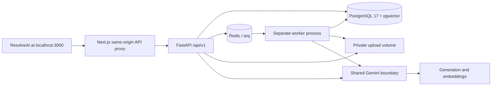

# ResolveAI system-design implementation map

Reference: the user's [19-page system design](design/ResolveAI_System_Design.pdf),
dated 5 October 2026. This map is the current implementation record, not a claim
that every planned product, cloud service or quality target has been delivered.

## Requested product workflow

The user's explicit change is one application, with company-document chat in
the ResolveAI Knowledge base dashboard and no separate personal CV chatbot.
The product lives at `/`; the old `/resolve` bookmark redirects there. A public
customer widget is not introduced as a second chat interface in this change.

The API commits document/draft records before enqueueing IDs. The worker's
dispatcher recovers durable queued records after a Redis interruption. Company
chat queries the Ready chunks for its workspace, applies cosine similarity
filtering, and generates a cited answer from at most five retrieved passages.

## Decisions applied from the PDF

| Design decision                                    | Implementation                                                                                                                            |
| -------------------------------------------------- | ----------------------------------------------------------------------------------------------------------------------------------------- |
| Modular monolith, API and separate worker          | One Python codebase; FastAPI plus Redis/arq worker in Compose                                                                             |
| Vectors in PostgreSQL, not a separate database     | pgvector column with 768 dimensions and HNSW cosine index; Pinecone removed from runtime                                                  |
| Tenant scoping plus database RLS                   | Workspace checks in routes; transaction-local actor/workspace settings; RLS on active business tables                                     |
| Migration owner separate from runtime              | API `resolveai_app`, worker `resolveai_worker`, original database owner for migrations; runtime roles are non-owner and cannot bypass RLS |
| Slow ingestion/drafting outside API                | Durable document/run records and separate arq jobs; draft request returns Processing immediately                                          |
| Private file storage                               | Opaque UUID keys in a shared local volume; no raw public file route                                                                       |
| One AI seam, versioned prompts                     | `backend/ai`; provider/embedding modules and versioned prompt files                                                                       |
| Structured outputs and guardrails                  | Pydantic validation, unsupported Gemini keyword removal, one repair attempt, citation validation, credential-pattern output blocking      |
| Bounded agent orchestration                        | Ordinary Python pipeline with a 30-second preparation budget; no LangGraph dependency                                                     |
| Model proposes, humans approve                     | Read-only typed order tool; proposed refund/replacement; administrator checks before sensitive mock execution                             |
| Durable action identity                            | Stored review request ID/hash, ticket revision, locked order, atomic mock mutation and audit; duplicate requests replay                   |
| One dashboard for company knowledge and operations | Company upload, persistent knowledge conversations, tickets, review, mock orders, team and activity in the root app                       |
| Versioned API and error shape                      | `/api/v1`, `error.code/message/request_id`, response request-ID header; frontend uses relative requests                                   |
| Testing against the actual stack                   | Real PostgreSQL/pgvector integration tests, non-owner RLS tests, real-SDK mock HTTP transport, frontend lint/build and browser checks     |

PostgreSQL remains on major version 17 and Next.js remains on version 16 rather
than downgrading existing working installations to the example versions in the
PDF. The database volume name is unchanged. Old accounts, support records and
document text remain. Archived personal-chat tables are not served by an API
and are not granted to runtime roles.

## Validation of this change

The backend suite passes 47 tests and 13 subtests against PostgreSQL/pgvector.
Alembic reports no schema drift, dependency checks pass, and frontend lint and
the production build pass. A browser check uploads the real demo-company PDF
through Redis and the separate worker, asks cited questions, reloads history,
checks responsive widths, and approves a mock refund only after review. A
separate HTTP check runs the API and worker with their non-owner database roles.

Provider transport tests do not spend credits; live Gemini access still needs
the user's private key and quota. A complete Docker image build could not be
verified in this cloud builder because its build container could not resolve
the Python package registry. The real database/Redis containers and native
API/worker/web processes were used for the integration checks above.

## Deliberate compatibility choices and remaining work

| PDF item                                                            | Current state / remaining work                                                                                                                                                                                                             |
| ------------------------------------------------------------------- | ------------------------------------------------------------------------------------------------------------------------------------------------------------------------------------------------------------------------------------------ |
| Rotating 15-minute access / 30-day refresh families                 | Existing revocable JWT cookies and CSRF retained; full refresh-family rotation is not implemented                                                                                                                                          |
| Public widget, allowed-origin customer sessions, streaming          | Current request is authenticated company-dashboard chat; no anonymous widget, public customer identity exchange or token SSE stream is exposed                                                                                             |
| Separate draft/action-request tables and execution/delivery jobs    | Existing ticket drafts and decision records retained. Drafting is queued. Approved actions and replies are local DB simulations in one atomic transaction; real external execution requires an outbox, worker job and provider idempotency |
| Exact ticket lifecycle and owner/admin/agent management API         | Existing owner/admin/agent capabilities retained with an admin gate for sensitive actions; complete invitation, reassignment, member removal and the PDF's expanded lifecycle are not all implemented                                      |
| Per-call `llm_calls`, dollar costs and hard daily token reservation | Current metrics record run tokens, latency, model, prompt version, errors and review feedback. Full per-call pricing/embedding-cost records and atomic daily budget reservations remain; no dollar amount is invented                      |
| Redis token buckets and response cache                              | Redis dispatches jobs; existing serialized per-workspace request budgets remain in PostgreSQL. Distributed token buckets/caching are not claimed                                                                                           |
| Generated OpenAPI TS client and cursor pagination everywhere        | Typed application client retained; complete code generation and cursor pagination remain                                                                                                                                                   |
| GCS, Cloud Run/SQL, Memorystore, Secret Manager                     | Local Docker stack implemented. Cloud adapters, staging/production deployment and credentials are separate work, not automatically published                                                                                               |
| structlog, OpenTelemetry, Sentry, alerting                          | Request IDs, server diagnostics and database run/audit records available; full distributed observability integrations remain                                                                                                               |
| Six labelled evaluation datasets and pass bars                      | Regression/integration checks and the 60-exercise demo pack exist. The PDF's faithfulness, recall, injection and p95 targets are not presented as measured results                                                                         |

Native mobile, MCP, real CRM/shop/payment integrations, email ingestion and
multilingual/voice remain outside the PDF's MVP as stated in the source design.
The implementation intentionally does not manufacture external transactions,
invent deployment credentials, or report unmeasured reliability/quality metrics.

## How to extend without splitting the application

Keep company documents, vectors, conversations and permissions in the current
workspace boundary. Add refresh rotation to auth without reintroducing personal
chat. Add a customer widget only through a scoped customer-session service and
the same knowledge/AI modules. Add real tools through stored approved actions
and a worker outbox. Move private file operations behind a GCS implementation
before separating API/worker into cloud services. Price model calls from
verified configured rates and preserve unknown cost as unknown.
