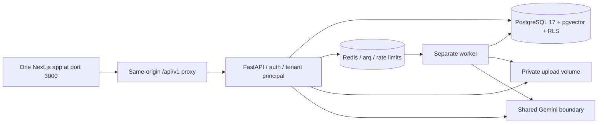

# ResolveAI system-design implementation map

Reference: the supplied [19-page PDF](design/ResolveAI_System_Design.pdf) and
[readable supplied text](design/ResolveAI_System_Design.txt), dated 5 October 2026.
This is the implementation record; it does not silently turn planned features
or quality targets into claims of completed production work.

## Current application

The user requested one company-dashboard application with document RAG inside
Knowledge base. ResolveAI is served at `http://localhost:3000`; `/` and the old
`/resolve` bookmark redirect to `/knowledge`. Authentication has dedicated
`/login` and `/signup` pages, with first-workspace onboarding. A personal CV
chatbot and its APIs are not present.

PostgreSQL stays on major version 17 and Next.js stays on version 16 to preserve
compatibility with the existing repository and database volume. Historical CV
records remain archived without an API or runtime-role table grants.

## Implemented design decisions

| Design area                        | Current implementation                                                                                                                                          |
| ---------------------------------- | --------------------------------------------------------------------------------------------------------------------------------------------------------------- |
| Modular monolith and worker        | One Python codebase, FastAPI API and separate Redis/arq worker in Compose                                                                                       |
| Auth pages and onboarding          | `/login`, `/signup`, `/onboarding`, protected dashboard, visible logout and actionable errors                                                                   |
| Access and refresh                 | 15-minute workspace-bound access JWT in memory; hashed 30-day opaque refresh cookie, rotation/reuse revocation, logout and daily expiry cleanup                 |
| Membership and roles               | Owner/admin/agent, live permission checks, recipient-accepted invitations, expiry/revocation, role changes and removal                                          |
| Active workspace                   | Explicit authenticated switch issues a new JWT; URL/body/query identifiers do not choose the tenant                                                             |
| Workspace settings and ownership   | Scoped name, answer tone and semantic threshold; protected owner role and name-confirmed owner-only deletion                                                    |
| Application and database isolation | TenantRepository filters, transaction-local actor/workspace, RLS and non-owner API/worker roles                                                                 |
| Consistent tenant writes           | Workspace advisory lock precedes child-row mutation; provider work runs outside it; final answer/draft state/access rechecked                                   |
| Company knowledge                  | PDF/DOCX/TXT/MD, private files, duplicate hashes, queued ingestion, fixed 768-dimensional Gemini embeddings, pgvector HNSW cosine search                        |
| Bounded retrieval and answers      | Eight candidates, similarity threshold, at most five sources, strict citations, refusal when evidence is missing                                                |
| Company conversations              | Saved threads and bounded follow-up context; IDs and history scoped to the active workspace                                                                     |
| Preparation and review             | Queued classification/retrieval/order lookup; versioned drafts, approval outbox, live role recheck, idempotent sample actions and real portal reply delivery              |
| AI boundary                        | Shared provider seam, versioned prompts, strict Pydantic output, supported Gemini schema, one repair attempt and credential-pattern output guard                |
| APIs                               | `/api/v1` auth/workspace/member/document/search/conversation/ticket/order/analytics/audit APIs; common errors/request IDs; same-origin Swagger at `/docs`       |
| Pagination                         | Workspace-bound cursors for canonical document/ticket/conversation/order/audit lists; compatibility dashboard remains bounded                                   |
| Rate limits                        | Redis token buckets for auth/API users, bounded standalone-development fallback, serialized per-workspace workflow limits                                       |
| Audit                              | Private account-security events and append-only tenant audit records; current role/member and review actions recorded                                           |
| Client identity                    | Account/workspace gating for preserved Next.js routes, unique form IDs, cleared forms on navigation, no silent cross-workspace retry                            |
| Automated checks                   | Real PostgreSQL/pgvector tests, non-owner RLS, real-SDK mock transport, frontend lint/build, committed Playwright browser tests and isolated Compose browser CI |

Migration owner credentials are used for schema/role setup and their named
environment variables are removed before the API starts. Local Compose can reuse
the original database password for convenience; separate strong runtime passwords
are required for a non-local deployment. No new paid service is needed for auth,
workspace membership or Local demo mode. Gemini mode uses provider quota.

## Validation

The backend suite passes **65 tests and 13 subtests** against real PostgreSQL
with pgvector. A separate actual-runtime check uses `resolveai_app` and
`resolveai_worker`, confirms RLS readiness, then exercises signup, signed workspace
access, Redis ingestion, cited company chat, cross-account denials, invitations,
live roles, owner-only deletion and logout.

Playwright browser scenarios exercise the actual local API and worker, including customer order intake, review and portal delivery. The checks are
committed in `frontend/e2e/auth-tenancy.spec.ts`. They cover
visible login/signup, error handling, reload/refresh across tabs, logout,
workspace/account boundaries, actual company-PDF ingestion, cited/history chat,
recipient invitations, roles, visible logout, guest/private customer sessions, approved delivery and responsive views. They use Local mode rather
than spending provider credits. GitHub Actions runs these on an isolated stack.

Live Gemini access still depends on the user's private key and quota. Provider
serialization tests use the actual SDK with an in-memory HTTP transport; they do
not prove a particular live account has model or embedding access. A full Docker
image build was previously blocked by this cloud builder's package-registry DNS;
the native API/worker/web with actual database/Redis containers provide the local
runtime evidence. CI now also checks the complete Compose deployment.

## Blueprint boundaries and remaining work

| PDF item                                                   | Current boundary / remaining work                                                                                                                                                                                                |
| ---------------------------------------------------------- | -------------------------------------------------------------------------------------------------------------------------------------------------------------------------------------------------------------------------------- |
| Public widget and customer flow | Implemented: one-hour conversation-bound sessions, private contact access links, SSE answer events, history/feedback, iframe embedding and exact-origin CSP                                                                                              |
| Ticket lifecycle naming | Assignment, priority, resolution/reopening, delivery-pending and replied states are implemented. Legacy open/processing/awaiting_approval names remain for compatibility rather than renaming historical records                                                                        |
| External financial integrations | Versioned reply drafts, action requests and an approval outbox are implemented. Replies reach the customer portal. Sample financial changes remain simulated; real payment/CRM writes need separate provider-specific integrations             |
| Per-call ledger, dollar pricing and hard daily budgets     | Current runs record model, tokens, prompt version, latency and errors. Embedding/per-call cost records and atomic daily token reservations are not yet implemented; no cost is invented or unsupported budget setting advertised |
| Cache and uniform generated client                         | Auth/request limits are distributed through Redis; response caching, generated OpenAPI TS client and pagination on every list remain                                                                                             |
| Production storage and cloud deployment                    | Local Docker/private-volume implementation is present. GCS, Cloud Run/SQL, Memorystore, Secret Manager and staging/production deployment are not automatically published                                                         |
| Complete observability and quality targets                 | Request IDs, run/audit/error records and regression tests exist. Full OpenTelemetry/Sentry/structured tracing, labelled eval datasets and measured faithfulness/recall/p95 targets remain                                        |

The original PDF remains the source blueprint. The implementation does not claim
that every planned service or target above has been delivered. Native mobile,
real CRM/shop/payment integrations, email ingestion, billing, multilingual and
voice remain outside the PDF's MVP as specified there.

## Customer workflow update

See [Customer workflow and integration guide](CUSTOMER_WORKFLOW.md) for the complete
portal setup, trust model, SSE events, approval/delivery lifecycle and optional
external order API contract. The application remains on one web origin. Customer
chat is opt-in per company; existing company knowledge is not published automatically.
A guest cannot obtain order access merely by claiming a customer's email.
